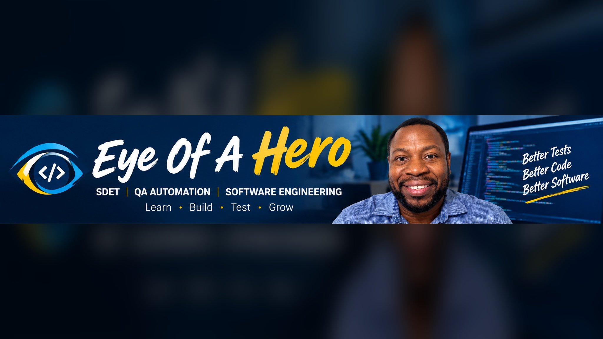

# 🎬 Notes Application Automation Framework

A comprehensive Playwright automation framework built to demonstrate modern software test automation techniques while serving as a practical learning resource for SDETs and QA Automation Engineers.

This project focuses on implementing common interview topics and real-world automation scenarios through working examples rather than isolated code snippets.

---
## 🎬 YouTube Playlist Automate Right With Playwright on the Eye Of A Hero channel

[](https://www.youtube.com/playlist?list=PLJ_hmx7qs4no)

---


# 🚀 Tech Stack

- Playwright
- TypeScript
- GitHub Actions (CI/CD Ready)

---

## ▶️ Test Execution

### Run Entire Test Suite

```bash
npx playwright test
```
### Execute a Single Test File

```bash
npx playwright test tests/ui/search/search.spec.ts
```

### Run in Headed Mode

```bash
npx playwright test --headed
```

### Debug Tests

```bash
npx playwright test --debug
```

### View HTML Report

```bash
npx playwright show-report
```

# Framework Features

## 🖥️ UI Automation

Current UI automation coverage includes:

- Login / Logout

## 🔌 API Testing

---

## CI/CD

GitHub Actions pipeline includes: pending

---

## Purpose

This project was created to:

- Demonstrate practical Playwright automation techniques.
- Provide runnable implementations of common interview topics.
- Serve as a reference framework for modern UI, API, integration, performance, accessibility, and security testing.

The goal is to bridge the gap between interview theory and real-world implementation.